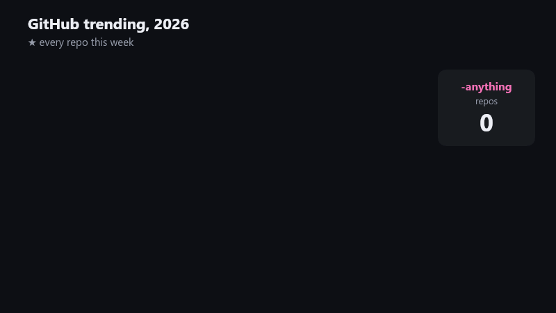

<p align="center">
  <picture>
    <source media="(prefers-color-scheme: dark)" srcset="https://raw.githubusercontent.com/EL4CTEO/anything-anything/main/docs/assets/wordmark-dark.png">
    
  </picture>
</p>

<p align="center"><b>Literally anything.</b></p>

<p align="center">
  <a href="https://www.npmjs.com/package/@el4cteo/anything-anything"></a>
  <a href="https://crates.io/crates/anything-anything"></a>
  <a href="https://github.com/EL4CTEO/anything-anything/actions/workflows/ci.yml"></a>
  
  
  
  <a href="LICENSE"></a>
</p>

<p align="center"></p>

Everyone's making an `-anything`. CLI-Anything, RAG-Anything, Understand-Anything, rust-anything, fast-anything...

**anything-anything** makes yours. Describe it in one line. Your coding agent designs it, builds it in whatever stack fits, and keeps going until **its own examples prove it works**. It comes out as a real project: CLI, MCP server, Claude Code plugin, skill, CI, release workflow, README, logo.

```sh
anything-anything new secrets "find leaked API keys and tokens in any codebase, before you push" --agent claude
```

## Install

```sh
npm i -g @el4cteo/anything-anything      # or: cargo install anything-anything
```

## How it works

1. **Design.** Your agent turns the idea into [`anything.toml`](docs/spec.md): the pitch, the commands, how it should work, and *examples*. An example is an exact run of the thing with exactly what must come out.
2. **Generate.** The stack's skeleton appears. Everything plumbing (argument parsing, `--json`, the MCP server, plugin, CI, packaging) is generated from the spec. The agent only writes the part that does the work.
3. **Build.** Your agent builds it. Then `verify` judges it, and the failures go back to the agent. Repeat until every gate passes.
4. **Publish.** `anything-anything publish` creates the GitHub repo, tags it so the hub finds it, and pushes the release.

## Proof, not vibes

`verify` runs every gate, in order, on Windows, macOS and Linux:

| gate | passes when |
|---|---|
| **spec** | `anything.toml` is complete: every command has an example, every example checks something |
| **files** | the generated files are exactly as generated. An agent can't edit the tests or the plumbing to pass: they're put back |
| **stubs** | nothing is left unbuilt (`ANYTHING:BUILD`, `todo!()`, `NotImplementedError`) |
| **steps** | the stack's own format, build, lint and test pass (`cargo clippy -D warnings`, `ruff`, `tsc --strict`...) |
| **mcp** | the MCP server answers both protocol eras and lists every command |
| **examples** | every example does exactly what it says: CLI runs, shell lines, HTTP requests, each in a fresh empty folder |

## Stacks

| stack | what you get |
|---|---|
| `rust-cli` | Rust 2024, one fast binary, MCP built in, npm (per-platform binaries) and crates.io releases |
| `python-cli` | Python 3.12+, typed, standard library only to start, MCP built in, uv / PyPI releases |
| `node-cli` | TypeScript run directly by Node 24+ (no build to try it), MCP built in, npm releases |
| `web` | Vite + TypeScript: web apps and games, tested in Node, deployed to GitHub Pages |
| `any` | anything else: Go, C#, Godot, Lua, a Roblox plugin... The design names its own build/test steps and how to run it |

A stack is [a folder of templates](templates) with a `stack.toml`. Adding one needs no code.

## Use

| command | what it does |
|---|---|
| `new <what> "<idea>" --agent claude` | design, generate, build, verify. `--stack` to choose, `--spec` to bring your own |
| `design --agent claude` | (re)write `anything.toml` from an idea |
| `build --agent claude` | build until every gate passes (`--attempts`, `--minutes`) |
| `task` | write `.anything/TASK.md` for any agent, or for you |
| `verify` | every gate (`--json` for machines) |
| `sync` | regenerate the plumbing after you change the spec. Never touches your code |
| `status` | the spec, the last verify, every build |
| `hub` | every -anything tool on GitHub (`search`, `show`, `install`, `made`) |
| `publish` | the plan; `--yes` to do it |
| `spec` · `stacks` · `doctor` | the format, the stacks, what's installed |

`--agent` takes `claude`, `codex`, or any command that reads a prompt on stdin.

## Agents

- **Claude Code plugin**: `/plugin marketplace add EL4CTEO/anything-anything`, then `/plugin install anything-anything@anything-anything` and `/anything-anything:anything a CLI that...`
- **MCP server**, built into the binary: `claude mcp add anything-anything -- anything-anything mcp`. There, the agent you're talking to is the builder: `anything_spec_format`, `anything_create`, `anything_task`, `anything_verify`, `anything_sync`, `anything_status`, `anything_stacks`, `anything_hub`.
- **Skill**: [`skills/anything-anything`](skills/anything-anything/SKILL.md)

## The hub

```sh
anything-anything hub                 # the most-starred -anything tools
anything-anything hub search video    # find one
anything-anything hub install CLI-Anything
anything-anything hub made            # tools made with anything-anything
```

## License

MIT
